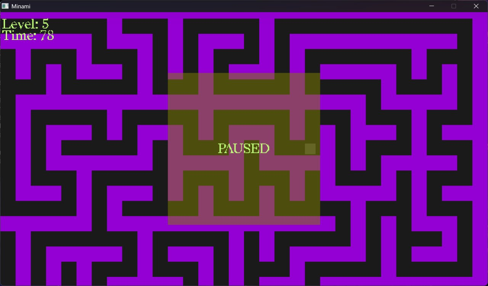

# Minami

A small 2D maze game written in C++17 with SDL3.
Every level is a freshly generated maze, each one bigger than the last,
and the clock is always ticking.

## Gameplay

Reach the green exit tile before time runs out. After each level the maze
grows and your time limit shrinks. There is no final level: how far can you get?

The time limit is calculated from the length of the shortest path
from start to exit, multiplied by a safety factor that gets smaller
with every level.

## Controls

| Key | Action |
|---|---|
| W A S D | Move |
| Enter | Start the game (main menu) |
| Esc | Pause / resume |
| Space | Next level (after winning) / restart from level 1 (after losing) |
| R | New maze on the current level (while paused) |
| N | Restart from level 1 (while paused) |

## Building (Windows, MinGW / GCC)

SDL3 and SDL3_ttf headers, import libraries and DLLs are included in the
repository, so you only need CMake and a MinGW-w64 GCC toolchain.

    cmake -S . -B build -G "MinGW Makefiles" -DCMAKE_BUILD_TYPE=Release
    cmake --build build

The build copies the SDL DLLs and the `assets` folder next to the executable.
Run `build/ProjectMinami.exe`.

## How it works

| Part | Responsibility |
|---|---|
| `Game` | Main loop, game states (menu, playing, paused, won, lost), input |
| `Player` | Position, movement, collision response against the grid |
| `Grid` | Tile map, collision queries, tile rendering (only visible tiles) |
| `Camera` | World-to-screen conversion, follows the player, stays inside the map |
| `MazeGenerator` | Maze generation (iterative recursive backtracker, seeded) |
| `Pathfinding` | Breadth-first search for the shortest path length |
| `LevelConfig` | Maze size and time factor for a given level |
| `Hud` | Text rendering with SDL3_ttf, cached textures |

Everything is drawn with plain rectangles, no sprites.

## Credits and licenses

- SDL3 and SDL3_ttf: zlib license, https://libsdl.org
- Font: Redaction 50 Regular, SIL Open Font License 1.1 (see assets/OFL.txt)
- See `THIRD_PARTY_NOTICES.md` for details.

The source code is released under the MIT license, see `LICENSE`.
Third-party components keep their own licenses, see `THIRD_PARTY_NOTICES.md`.